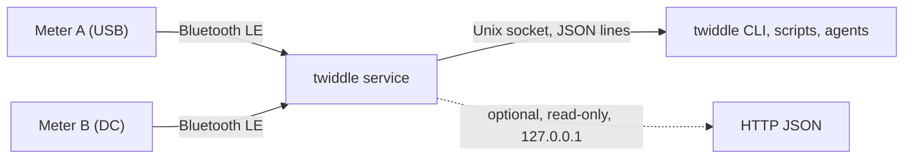

# Twiddle

**Read your ATORCH USB and DC power meters from one command, without fighting over their single Bluetooth connection.**

<!-- bricoleur:intro -->
<!-- /bricoleur:intro -->



## What it does

- Keeps one Bluetooth LE connection open to each meter you name, and reconnects when it drops. By
  default it waits 2 seconds between attempts, and restarts a connection that sends nothing for
  12 seconds.
- Hands each meter's latest reading (voltage, current, power, energy, temperature, runtime, and
  charge on USB meters) to the `twiddle` command over a local Unix socket. If you turn it on, it
  also serves them as read-only JSON over HTTP on 127.0.0.1.
- Clears a meter's counters when you ask and confirm, using the command for that meter's own type.

## Quick start

You need Linux with BlueZ (its Bluetooth stack), Python 3.11 or newer, and an ATORCH UD18- or
DL24-class meter in range. On a Raspberry Pi, your user must be in the `bluetooth` group.

```sh
git clone https://github.com/shawnrancatore/twiddle
cd twiddle
python3 -m venv .venv
. .venv/bin/activate
pip install -e .
twiddle scan
```

`twiddle scan` listens for 8 seconds and lists the meters it hears advertising FFE0, the
Bluetooth service these meters use. `(unmapped)` means the address is not in your config yet:

```text
ATORCH-class (FFE0) devices seen in 8s:
  AA:BB:CC:DD:EE:01  rssi=-58  (unmapped)
  AA:BB:CC:DD:EE:02  rssi=-71  (unmapped)
```

Copy the example config:

```sh
cp config.example.toml twiddle.toml
```

In `twiddle.toml`, each meter is a `[devices.<name>]` table with its `mac` and an optional `note`.
Replace the two examples, `meter-a` and `meter-b`, with your meters' addresses and names. Then
start the service:

```sh
twiddle service
```

It logs `listening on …`, then `connected` for each meter it reaches. In a second terminal, in the
same folder, activate the venv again and list the meters:

```sh
. .venv/bin/activate
twiddle list
```

```text
meter-a  AA:BB:CC:DD:EE:01  online  (USB load test)  [0.8s ago]
    USB  V=5.08V  I=0.52A  P=2.642W
    cap=1.234Ah  energy=6.27Wh  runtime=2h03m04s  temp=27C
meter-b  AA:BB:CC:DD:EE:02  online  (DC supply)  [0.6s ago]
    DC  V=12.3V  I=1.234A  P=15.1W
    energy=45.67Wh  runtime=0h41m10s  temp=31C
```

**How to tell it worked:** each meter's first line says `online`, followed by a small age such as
`[0.8s ago]`, the time since its last report.

A meter shown as `OFFLINE` with `last_error: TimeoutError: not advertising` was not found. Check
that it is on, in range, and not connected to something else, such as the phone app. The service
keeps retrying.

## How it works

The meters' Bluetooth module takes one connection at a time and drops it often. So one process,
the service, holds that connection for each meter. It connects the meters one after another,
because scans running in parallel collide in BlueZ, and then keeps them all connected. It decodes
the report frame (a 36-byte packet) that each meter sends about once a second, and keeps the
latest. When a connection fails or goes quiet, it reconnects. By default, after every 6 failures
in a row it clears BlueZ's cached state for that meter with `bluetoothctl remove`. The `twiddle`
command asks the service over its socket. With no service running, `get` and `reset` connect to
the meter directly, once. The frame layout and the reset commands are in [docs/PROTOCOL.md](docs/PROTOCOL.md).

## What it deliberately does not do

- **Linux with BlueZ only.** It names meters by MAC address, serves a Unix socket, and
  calls `bluetoothctl`.
- **No pairing and no authentication.** The meters accept commands with no pairing or keys. While
  Twiddle is not connected to a meter, any device in Bluetooth range can connect to it, read it,
  or clear its counters. Twiddle adds no login of its own.
- **No history.** It keeps only each meter's latest reading, in memory, and never writes a
  reading to disk. A restart forgets every reading.
- **No guard on the socket beyond its file permissions.** The service creates the socket with mode
  0660, so its owner and its group can read every meter and reset any counter. A reset request
  must carry `"confirm": true`. That stops a request sent by mistake, not a hostile one. The CLI
  asks before it sends one, unless you pass `-y`.
- **No HTTP unless you set `http_port`.** Then it listens on 127.0.0.1 only, answers `GET` only,
  and cannot reset anything. It has no authentication, so any program on the machine can read it.
  It sends no CORS header (the header that lets pages from another site read an answer) unless
  you name one origin, such as `http://localhost:3000`, in `http_cors_origin`. It also refuses requests whose `Host` is not
  `127.0.0.1` or `localhost`, so a web page cannot get round this by pointing its own host name at
  127.0.0.1.

## Commands

| Command | What it does |
|---|---|
| `twiddle list` | every configured meter and its latest reading |
| `twiddle get <name>` | one meter; with no service running, connects to it directly once |
| `twiddle watch <name>` | `get` every second (`--interval` to change) until Ctrl-C |
| `twiddle reset <name>` | clear counters; `--counter` is `all` (default), `wh`, `ah` or `duration`; `-y` skips the question |
| `twiddle scan` | list meters advertising FFE0 (`--duration`, default 8 seconds) |
| `twiddle service` | run the service in the foreground |
| `twiddle config` | print the effective configuration as JSON |

`--config <path>` and `--socket <path>` go before the command. Every command but `service` and
`config` takes `--json`. Exit codes: `0` success, `1` runtime error, `2` usage error or unknown
meter name. Coding agents: see [AGENTS.md](AGENTS.md).

## Configuration

Twiddle reads the first TOML file it finds: `--config`, `$TWIDDLE_CONFIG`, `./twiddle.toml`,
`~/.config/twiddle/config.toml`, `/etc/twiddle/config.toml`. With none, it uses the defaults below
and has no meters. [config.example.toml](config.example.toml) lists every setting.

| Setting | Default | Meaning |
|---|---|---|
| `[service] socket` | `$TWIDDLE_SOCKET`, else `$XDG_RUNTIME_DIR/twiddle.sock`, else `/tmp/twiddle.sock` | the Unix socket; `--socket` overrides it |
| `[service] http_port` | off | port for the read-only HTTP endpoint on 127.0.0.1 |
| `[service] http_cors_origin` | none | one web origin whose pages may read the HTTP endpoint; not `*` or `null` |
| `[service] log_level` | `INFO` | service log level |
| `[ble] connect_timeout` | `8.0` | seconds per connect attempt, scan included |
| `[ble] reconnect_delay` | `2.0` | seconds between reconnect attempts |
| `[ble] stale_timeout` | `12.0` | reconnect after this many seconds without a frame |
| `[ble] command_timeout` | `8.0` | seconds the service waits for a reset to be written |
| `[ble] clear_cache_after` | `6` | run `bluetoothctl remove <mac>` after every N failures; `0` never |
| `[devices.<name>] mac` | | the meter's address, from `twiddle scan` |
| `[devices.<name>] note` | | free text that `list` shows |

## Reading fields

Which fields a reading carries depends on the meter type in its frame. `null` means that type's
frame does not carry the field.

| Field | Meaning | Unit | USB meter | DC meter |
|---|---|---|---|---|
| `device_type` | meter type from the frame | | `USB` | `DC` |
| `voltage` | bus voltage | V | yes | yes |
| `current` | bus current | A | yes | yes |
| `power` | power | W | computed, V × I | from the frame |
| `capacity_ah` | accumulated charge | A·h | yes | `null` |
| `energy_wh` | accumulated energy | W·h | yes | yes |
| `usb_dplus`, `usb_dminus` | USB data-line voltages | V | yes | `null` |
| `temperature_c` | meter temperature | °C | yes | yes |
| `runtime_s` | accumulated runtime | s | yes | yes |
| `checksum_ok` | frame checksum matched | bool | yes | yes |
| `raw` | the whole frame, as hex | | yes | yes |

An AC meter reports `device_type` `AC`, and Twiddle reads its frame with the DC layout. That
layout is not documented for AC meters, and no AC meter has been tested.

## Resetting counters

`twiddle reset <name>` permanently clears the meter's accumulated energy (`wh`), charge (`ah`),
runtime (`duration`), or all of them (`all`, the default). The CLI asks first unless you pass
`-y`:

```text
Clear 'all' counter(s) on meter-b (AA:BB:CC:DD:EE:02)? This is irreversible. [y/N]
```

With the service running, the request goes over the socket with `"confirm": true`. Without it, the
CLI connects to the meter directly. Either way, the command carries the meter's own type (USB, DC
or AC), read from its last report frame with a valid checksum. Until the meter has sent one,
nothing is sent.

## The socket

One JSON object per line, one answer per line:

| Request | Answer |
|---|---|
| `{"cmd": "list"}` | `{"ok": true, "devices": {"meter-a": <status>, ...}}` |
| `{"cmd": "get", "device": "meter-a"}` | `{"ok": true, "status": <status>}` |
| `{"cmd": "reset", "device": "meter-a", "counter": "all", "confirm": true}` | `{"ok": true}` |
| `{"cmd": "ping"}` | `{"ok": true, "service": "twiddle", "version": "0.1.0", "devices": [...]}` |

Errors answer `{"ok": false, "error": "..."}`. AGENTS.md shows a full `<status>`. If the socket
exists but you may not open it, the CLI stops with `permission denied` and does not connect to
the meter itself.

## HTTP endpoint

Set `http_port = 8731` in `[service]`, restart the service, and:

```sh
curl -s http://127.0.0.1:8731/
curl -s http://127.0.0.1:8731/device/meter-a
```

| Request | Result |
|---|---|
| `GET /` or `GET /devices` | `200`, every meter |
| `GET /device/<name>` | `200`, one meter · `404` unknown name |
| any other path | `404` |
| any method but `GET` | `405` |
| a `Host` other than `127.0.0.1` or `localhost` | `403` |
| a malformed request | `400` |

## Run as a systemd service

1. Copy the config and the unit:

   ```sh
   sudo install -D -m 644 config.example.toml /etc/twiddle/config.toml
   sudo cp systemd/twiddle.service /etc/systemd/system/
   ```

2. Put your meters in `/etc/twiddle/config.toml`. In `/etc/systemd/system/twiddle.service`, set
   `ExecStart` to your `twiddle`, for example `/opt/twiddle/.venv/bin/twiddle service`.
3. Start it and read its log:

   ```sh
   sudo systemctl daemon-reload
   sudo systemctl enable --now twiddle
   sudo journalctl -u twiddle -n 5
   ```

The unit puts the socket at `/run/twiddle/twiddle.sock`. As shipped, it runs as root, so the
socket belongs to user and group `root`, and other users get `permission denied`. To let members
of the `bluetooth` group use it, uncomment `User=` and `Group=bluetooth` in the unit, and set
`User=` to an account that may use BlueZ. Then point the CLI at the socket:

```sh
twiddle --socket /run/twiddle/twiddle.sock list
```

**How to tell it worked:** the journal shows `listening on /run/twiddle/twiddle.sock (devices: …)`,
then `connected` for each meter.

## Tests

```sh
pip install -e '.[test]'
python -m pytest
```

The tests need no meter and no Bluetooth. They check the codec against a real captured USB frame
and synthetic DC frames, both reset paths, the socket and HTTP handlers, and the CLI's reset. They
do not cover a real meter or BlueZ.

## Protocol

See [docs/PROTOCOL.md](docs/PROTOCOL.md). It builds on the reverse engineering in
[syssi/esphome-atorch-dl24](https://github.com/syssi/esphome-atorch-dl24) and
[NiceLabs/atorch-console](https://github.com/NiceLabs/atorch-console).

## The full guide

From finding your meters to resetting counters, with the reasoning behind each limit:
**[bricoleur.ai/projects/twiddle](https://bricoleur.ai/projects/twiddle)**.

<!-- bricoleur:footer -->
<!-- /bricoleur:footer -->
